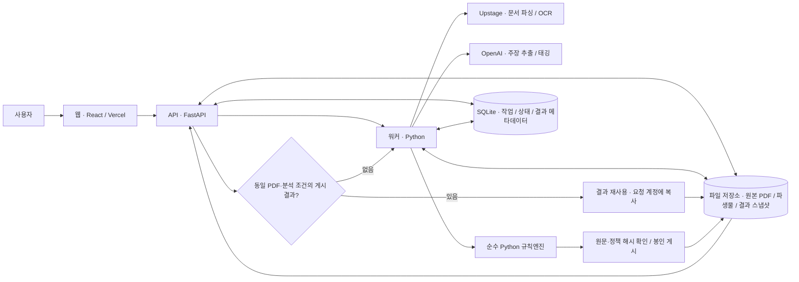
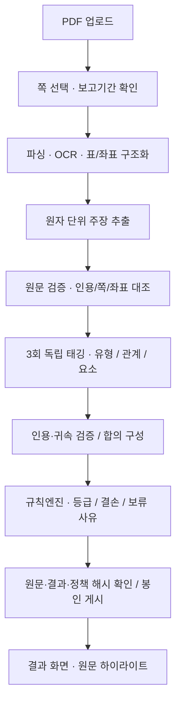

# ESG ProofOps

**지속가능성 공시의 환경 주장을 원문 근거와 연결하는 발간 전 검토 도구입니다.** PDF에서 목표·성과·관리체계 주장을 추출하고, 규칙엔진으로 입증 등급(E0–E3), 부족한 요소, 보류 사유를 보여줍니다. 공시 작성자와 검토자는 주장별 결과에서 해당 PDF 쪽과 근거 하이라이트로 이동해 보완할 내용을 확인할 수 있습니다.

**[서비스 데모](https://esg-proofops.vercel.app) · [분석 사례](https://esg-proofops.vercel.app/demo)** — 행사 기간에는 비밀번호 없이 공개 체험할 수 있습니다(2026-10-20 23:59 KST까지). 방문자별 자료는 분리되며 새 분석은 방문자당 하루 2건입니다. 우측 상단 **관리자 로그인**은 별도 계정으로 이용합니다.

체험 기간이 끝나면 비밀번호 없는 접속은 종료되며, 서비스의 로그인·이용 안내를 확인해 주세요.

## 사용 흐름

1. **분석 사례**에서 NAVER 2025의 현재 결과를 살펴보거나, 보고서 PDF를 업로드하고 분석할 쪽과 보고기간을 확인합니다.
2. 분석 진행 상태를 확인한 뒤 **요약 / 문장별 결과 / 원문 대조** 3개 탭에서 등급·판정 이유·결손 요소를 살펴봅니다.
3. 원문 대조에서 해당 쪽의 인용과 하이라이트를 확인합니다. 원문 미확인 주장의 위치는 점선과 **추정 위치(원문 대조 전)**로 구분합니다.
4. **보관함**(`/archive`)에서 내 보고서와 결과를 다시 엽니다. 같은 PDF와 분석 조건에 맞는 게시 결과가 있으면 이전 분석 결과를 재사용합니다.

등급은 분석 범위에서 확인한 **문서 내 입증 수준**을 나타냅니다. E3는 입증 요소 충족, E1·E2는 일부 충족, E0는 **분석 범위 안에서 요구되는 입증 근거를 확인하지 못한 수준**을 뜻합니다. 보고서 전체에 근거가 없거나 주장이 허위라는 판정이 아닙니다. 판정할 수 없는 주장은 사유와 함께 보류로 표시합니다.

## 아키텍처



웹은 Vercel에서 제공하고, API와 워커는 Docker 실행 구성을 공유합니다. API가 작업을 접수하면 워커가 저장된 작업을 가져와 분석합니다. 원본·파생물·게시 스냅샷은 파일 저장소에, 작업 상태와 접근 정보는 SQLite에 보관합니다. 결과 재사용은 원본 PDF 해시, 분석 정책, 선택 범위, 보고기간이 일치하고 게시 스냅샷의 무결성이 확인된 경우에 적용합니다.

## 분석 파이프라인



유형은 목표·성과·관리체계를 구분하고, 관계는 주장과 근거의 연결을, 요소는 해당 주장의 입증에 필요한 항목을 태깅합니다. 각 회차는 고정된 근거 묶음을 읽고 별도 실행 기록을 남깁니다. 게시 시 원문과 산출물의 연결을 확인한 스냅샷을 화면에 제공합니다.

## 핵심 설계 원칙

- **LLM은 추출·태깅만 수행합니다.** 등급과 라벨은 검증된 태깅을 입력으로 받는 순수 Python 규칙엔진이 계산합니다.
- **모든 근거를 원문으로 추적합니다.** 문서 버전, 쪽, 좌표, 인용, 원문 해시를 보존하고 `present`는 원문 검증을 거친 근거에만 부여합니다. 다른 위치의 근거도 주장과 주체·지표·기간이 맞는지 확인합니다.
- **합의와 결손 처리를 정책에 고정합니다.** 유형 3/3·요소 2/3 합의와 분석 범위 내 근거 부재 처리를 지원하며, 근거 충돌·원문 미검증·유형 미합의·규칙 미정·미처리는 보류 사유로 보존합니다. 적용 조건은 실행에 기록된 정책을 따릅니다.
- **게시 결과를 재현 가능한 형태로 보존합니다.** 모델·프롬프트·규칙·정책 해시와 독립 태깅 기록을 남기며, 재분석은 기존 결과를 덮어쓰지 않습니다.
- **계정별 접근과 재사용을 함께 관리합니다.** 원본은 업로드한 계정에 귀속하고, 재사용 시 결과 식별자를 요청 계정에 맞게 다시 연결합니다.

## 기술 스택

| 영역 | 기술 | 역할 |
|---|---|---|
| 웹 | React 19, TypeScript, Vite 6, PDF.js | 분석 요청, 결과 탐색, PDF 원문 표시 |
| API | Python 3.12, FastAPI, Pydantic | 인증·업로드·작업 접수·결과 제공 |
| 워커 | Python, Upstage, OpenAI | 파싱·OCR·주장 추출·독립 태깅 |
| 로컬 문서 처리 | OpenDataLoader PDF, Java 21, pdfplumber, pypdf, Tesseract | PDF 구조 추출과 원문 검증 |
| 판정 | 순수 Python, JSON/YAML 규칙팩 | 등급·라벨·결손·보류 사유 계산 |
| 저장 | SQLite, 파일 저장소, SHA-256 | 작업 상태, 원본·파생물, 불변 스냅샷, 결과 재사용 |
| 실행 환경 | Vercel, Docker, uv, pnpm | 웹 제공, 서버 실행, 의존성 고정 |

## 실행

저장소 루트에서 실행합니다. 웹에는 Node.js 22와 pnpm 10, Python 실행 도구에는 Python 3.12와 uv가 필요합니다.

### 키 없이 웹 분석 사례 보기

```bash
pnpm install --frozen-lockfile
VITE_DEMO_STATIC=true VITE_ANALYSIS_BACKEND=static pnpm --filter proofops-web dev
```

출력된 로컬 주소의 `/demo`를 엽니다. 이 모드는 저장된 사례를 보여줍니다. 웹 빌드는 `pnpm build`로 생성합니다.

### Python 도구 준비

```bash
uv sync --locked
uv run python scripts/analyze_report.py --help
uv run python scripts/submission_demo.py --help
```

`analyze_report.py`는 PDF·쪽·보고기간을 받아 분석 실행 계획을 구성하며, `--invoke`를 지정해야 실제 분석을 실행합니다. 실제 분석에는 승인된 모델 설정·문서 처리 권한·예산과 서버 측 키가 필요합니다.

### 저장된 분석 상태로 로컬 검토 화면 열기

접근 권한이 있는 분석 상태 디렉터리(`pilot.json` 포함)를 준비한 뒤 실행합니다. 상태 파일은 저장소에 포함되지 않습니다.

```bash
pnpm build
uv run python scripts/submission_demo.py --seed /path/to/saved-pilot-state --port 8790
```

출력되는 로컬 로그인 URL을 엽니다. 런처는 원래 상태를 보존하고 복사본을 사용하며 새 모델 분석을 호출하지 않습니다.

### API와 서버 실행 구성

로컬 API 진입점은 다음과 같습니다. 저장 사례 화면과 실제 분석 서버는 서로 다른 실행 모드입니다.

```bash
uv run uvicorn proofops_api.main:app --host 127.0.0.1 --port 8000
```

실제 파싱에는 Java 21과 PDF/OCR 런타임이 필요합니다. 서버 런타임은 [Dockerfile](deploy/public/Dockerfile), API·워커 구성은 [Compose](deploy/ec2/compose.yaml), 설정 항목은 [.env.example](.env.example)과 [서버 환경변수 예시](deploy/ec2/runtime.env.example)에 있습니다. `APP_ENV=hosted`는 운영 API 구성을 선택합니다. 업로드와 실제 모델 호출은 서버 설정에서 명시적으로 활성화해야 하며, 비밀값은 서버 환경 또는 별도 비공개 파일로 공급합니다.

## 구조

```text
apps/
  web/          React 웹과 PDF 원문 뷰어
  api/          FastAPI · 업로드 · 작업 · 게시 결과
  worker/       파싱 · 추출 · 태깅 실행
  agent/        LLM 요청 구성과 구조화 출력 검증
packages/
  proofops/
    domain/     문서·근거 타입과 순수 규칙엔진
    application/ 분석 흐름 · 근거 연결 · 태깅 합의
    adapters/   파서 · 모델 통신 · 저장 구현
config/         규칙팩과 실행 설정
contracts/      API·데이터 스키마
prompts/        추출·태깅 프롬프트
evaluation/     서버·로컬 실행에서 사용하는 런타임 모듈
scripts/        실행·관리 명령
deploy/         Docker·서버 실행 구성
infra/          인프라 코드
tests/          테스트 코드
fixtures/       테스트 입력
```

## 어디서부터 읽을까

| 확인할 내용 | 시작 파일 |
|---|---|
| 사용자가 보고서를 올리고 결과를 여는 흐름 | [HostedAnalysis.tsx](apps/web/src/features/hosted/HostedAnalysis.tsx) → [HostedResult.tsx](apps/web/src/features/hosted/HostedResult.tsx) |
| API 요청부터 작업 접수까지 | [main.py](apps/api/src/proofops_api/main.py) → [hosted.py](apps/api/src/proofops_api/hosted.py) → [hosted_store.py](apps/api/src/proofops_api/hosted_store.py) |
| 서버 워커에서 분석 단계 실행까지 | [hosted_control.py](scripts/hosted_control.py) → [hosted_analysis.py](apps/api/src/proofops_api/hosted_analysis.py) → [hosted 분석 실행](evaluation/hosted_r108.py) → [worker/composition.py](apps/worker/src/proofops_worker/composition.py) |
| 근거 묶음과 독립 태깅·기초 합의 | [retrieval.py](packages/proofops/application/evidence/retrieval.py) → [service.py](packages/proofops/application/tagging/service.py) → [기초 합의 consensus.py](packages/proofops/application/tagging/consensus.py) |
| 현재 유형 3/3·요소 2/3 확정 경로 | [worker/tag_runner.py](apps/worker/src/proofops_worker/tag_runner.py) → [cf6_confirmation.py](packages/proofops/application/tagging/cf6_confirmation.py) → [cf6_scope.py](packages/proofops/domain/rules/cf6_scope.py) |
| 등급이 결정되는 규칙 | [engine.py](packages/proofops/domain/rules/engine.py) · [cf6_scope.py](packages/proofops/domain/rules/cf6_scope.py) · [규칙 설정](config/rubric/) |
| 원문 검증에서 하이라이트까지 | [source_verification.py](packages/proofops/adapters/local/source_verification.py) → [hosted_source_view.py](apps/api/src/proofops_api/hosted_source_view.py) → [SourceSplitView.tsx](apps/web/src/features/hosted/SourceSplitView.tsx) |
| 봉인 게시와 결과 재사용 | [hosted_publication.py](apps/api/src/proofops_api/hosted_publication.py) · [hosted_reuse.py](apps/api/src/proofops_api/hosted_reuse.py) |

폴더별 역할과 진입점은 [apps 안내](apps/README.md)와 [packages 안내](packages/README.md)에서 이어집니다.
